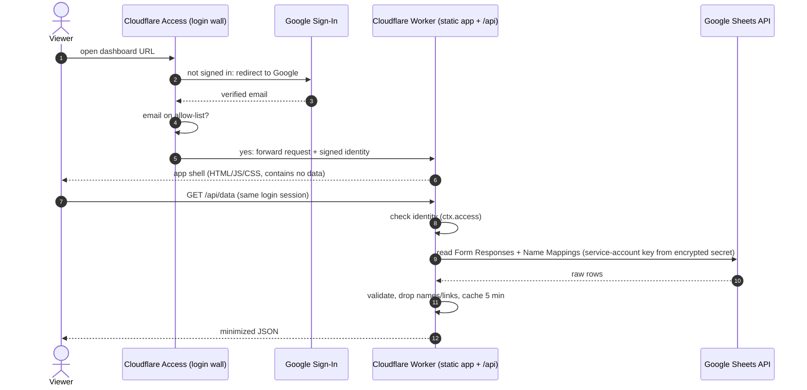

# Kiwimbi Kenya Dashboard: Rebuild Plan

_September 2026 · **Decision: built as a Google Apps Script web app** (see §2A and the README)._

> This file is safe for a public repo. It describes the **schema and the design**, never the data.
> Real numbers, names and photos stay in the Google Sheet.

---

## 0. The short version

| Question | Answer |
|---|---|
| **What format?** | A **single-page app** (HTML/CSS/JS built by Vite into one file) **plus a small server** that reads the data. |
| **GitHub Pages?** | **Keep the code on GitHub, but don't host on GitHub Pages.** Pages serves every file to the public internet and cannot put a login in front of anything. |
| **Where does it live?** | **Chosen: a Google Apps Script web app** deployed "execute as me" for "anyone within kiwimbi.org". Google requires a Kiwimbi sign-in before anything loads (kiwimbi.org runs on Google Workspace). *Considered: a Cloudflare Worker behind Cloudflare Access (§2.1).* |
| **How does data get in?** | The browser never talks to Google Sheets. The script reads the sheet **as its owner, inside Google**, with no keys to store anywhere. It strips names and links, and sends only what the charts need. A trigger refreshes the cache every 5 minutes. |
| **What do forks get?** | Code, the column-to-metric mapping, and a **synthetic data generator**. No sheet ID, no keys, no data. A fork runs the full dashboard on fake numbers. |
| **Time range?** | One filter bar, **Year-to-date by default**, with presets, a draggable brush and custom dates. |
| **Smoothing?** | Each report is **spread across the days it actually covers**, then shown as weekly bars + a 4-week trend line. No more fake one-month spikes or fake zeros. |
| **Look?** | kiwimbi.org's leaf / water / earth / sun colors (re-stepped so charts pass colorblind + contrast checks), Montserrat + Lato, light & dark mode. |
| **Cost?** | $0, with no viewer limit. |

---

## 1. Starting point

### 1.1 Data source (schema only)

- A Google Form feeds the **`Form Responses`** tab: one row per submission, ~55 columns.
- Each metric has **its own value column and its own Starting/Ending Date pair** (e.g. `Starting Date 5`, or
  `Starting Date\nInput the MONTH / DAY / YEAR (Sports)`). Pairs are not always adjacent. The metric registry (§3.1)
  maps them explicitly.
- Metrics: library visits · books checked out · primary / secondary classes taught · meals (Amagoro, Kidek, Ikapolok,
  Staff & Tailoring) · agronomy attendees / workshops · holiday-camp students · computer-lab users · art / sports /
  tailoring / carpentry attendance.
- Supporting tab used by the new pipeline: **`Name Mappings`** (canonical submitter names).
  The other formula tabs (Reference sheets, `Looker *`, Program Insights, KPI, Manager Dashboard, Data Aggregated) are
  replaced by the new pipeline and can be retired after cut-over.

### 1.2 Realities of the data the design must handle

| Reality | Design consequence |
|---|---|
| Reports cover a **date range**: mostly 1 day (class logs) or 1 week (Mon–Fri / Mon–Sun), but a few catch-up reports span 4–13 weeks | Spread values across their range; never bucket by a single date |
| Activity date ≠ submission date (lag usually 0–4 days, occasionally ~2 weeks) | Chart by **activity** date; mark the latest 2 weeks *provisional* |
| Long stretches with no reports (holidays, reporting gaps) | Show **"no reports"** as a gap, never as 0 |
| `Program Type` doesn't reliably match the fields filled in (e.g. enrichment attendance submitted under Library) | Identify metrics by **value column**, ignore `Program Type` |
| Free-text names with spelling variants; test submissions | Normalize via `Name Mappings`; drop test rows |
| Occasional text in number fields, missing end dates, year typos, probable duplicate weekly reports | Strict parsing + visible **Data health** flags, not silent coercion (today's `REGEXREPLACE("[^0-9]")` turns `20-25` into `2025`) |
| Weekly headcounts (same class every week) are summed across weeks | Label sums as **attendances (student-sessions)** and also show **typical weekly headcount**, so 20 students × 4 weeks isn't read as "80 students" |

### 1.3 What the old Looker Studio report gets wrong

- Month buckets keyed on one date: an 11-week catch-up report becomes a single-month spike and the weeks it covered read 0.
- Months with no reports plotted as **0**.
- Library month axis sorted by value instead of time (Jan, Aug, Sep, Jul).
- Non-zero y-axis baselines on single-point charts (e.g. 685–687).
- Pies, single-bar bar charts, "No data" KPI pills.
- Ten pages, each with its own date filter and a different default range.
- Heavy saturated header bands, bevelled pills, mixed fonts.
- Every viewer must be given access to the raw sheet.

---

## 2A. Chosen: Google Apps Script (implemented)

Kiwimbi's email runs on Google Workspace, so a web app limited to the kiwimbi.org domain gets
Google's own sign-in wall with no third party and no keys:

| Concern | How the Apps Script build handles it |
|---|---|
| Login before anything loads | Deployment access "Anyone within kiwimbi.org"; the server re-checks each call (`ALLOWED_DOMAIN`, optional `ALLOWED_EMAILS`) and fails closed |
| Viewers never need the raw sheet | Runs "as me" (the owner); remove viewers from the sheet's sharing after cut-over |
| Names stay private | Public payload has no reporter names or ids; mentor counts are pre-aggregated per week, month, term and preset range. Names, row links and issue details go to `MANAGER_EMAILS` only |
| Only intended functions are callable | Bundle is an IIFE; six top-level wrappers only (`doGet`, `getDashboardData`, `getOpsData`, `refreshCache`, `installTriggers`, `checkSetup`); maintenance ones refuse viewers |
| No secrets in Git | Sheet ID and access lists in Script Properties; hash key generated there; `.clasp.json` git-ignored; no Google credentials in CI; no-data guard as pre-commit/pre-push hooks and in CI |
| Freshness | CacheService (chunked) + 5-minute time-driven trigger; the page re-fetches every 10 minutes |
| Proof | `tests/gas-bundle.test.ts` runs the real `Code.js` against simulated Google services: denies Gmail/blank identities, hides names from viewers, blocks maintenance calls from the web app |

The sections below record the original comparison. The Cloudflare design remains a valid fallback
if people outside kiwimbi.org ever need live access.

## 2. Hosting & security (original comparison)

### 2.1 Recommended architecture



| Layer | Choice | Why |
|---|---|---|
| Code | GitHub repo (public or private) | Holds only code + schema; safe to fork |
| Build & deploy | Cloudflare **Workers Builds** (Git integration) | Deploys on push to `main`; preview build per branch; no deploy token stored in GitHub |
| Hosting | One **Cloudflare Worker with static assets** + `/api/*` handler | Cloudflare's recommended setup for new projects (Pages is still supported, but new features land in Workers). App and API sit behind the same login |
| Login wall | **Cloudflare Access** (Zero Trust), Worker-level, set to **"All traffic"** | Covers *every* URL of the Worker: `*.workers.dev`, preview URLs, custom domain. Free for ≤ 50 users |
| Identity | **Google** as the Access login method (the **Google Workspace** connector if Kiwimbi uses Workspace) | "Sign in with Google". Workspace adds group-based rules and automatic offboarding |
| Data access | Google Cloud **service account** shared as **Viewer** on the one sheet | Key lives in Cloudflare secrets only: never in Git, never in the browser |

> If the Worker-level Access toggle ever can't offer the Google login method, the classic **self-hosted Access
> application** on the hostname(s) does the same job with any identity provider.

### 2.2 Why not GitHub Pages (and the alternatives, compared)

GitHub Pages serves every file publicly, even from a private repo. (Private Pages needs GitHub Enterprise Cloud and
gates on GitHub accounts, not Google.) So a Pages design has to let the **browser** pull data straight from Google
with each viewer's own Google token (Option B). That works, but:

- the app itself loads for anyone; only the data is gated;
- every viewer must be shared on the **raw sheet**, so they can open every row, including submitter names, unless
  you maintain a second de-identified "feed" spreadsheet;
- it needs an OAuth app requesting the **sensitive** `spreadsheets.readonly` scope: "Internal" (Workspace only),
  or Google's verification process, or an "unverified app" warning capped at 100 test users;
- there's no server-side place to strip names, enforce roles or cache.

| | **A. Cloudflare Worker + Access** (recommended) | B. GitHub Pages + in-browser Google OAuth | C. Google Apps Script web app |
|---|---|---|---|
| Login before *anything* loads | ✅ | ❌ app loads; data gated | ✅ |
| Viewers need access to raw sheet | ❌ no | ✅ yes | ❌ no ("execute as me") |
| Names stripped server-side | ✅ | ❌ | ✅ |
| Per-person allow-list & instant revoke | ✅ Access policy | via sheet sharing | domain-wide, or custom code |
| Fully custom modern UI | ✅ | ✅ | ⚠ runs in an iframe on script.google.com; slower |
| Secrets in repo | none | none (OAuth client ID is public by design) | none |
| Cost | $0 ≤ 50 users | $0 | $0 |

Option C is a fair fallback **only if** every viewer has a Kiwimbi Google Workspace account and a script.google.com URL is acceptable.

**Never use:** "Publish to web" CSV links · Sheets API keys (only work on public sheets) · committing exports ·
password-encrypted static pages (e.g. StatiCrypt: one shared password, brute-forceable offline, no per-person revoke,
and the data would sit in the repo) · Looker "anyone with the link".

### 2.3 Security controls

**Identity & access**
- Access policy **Allow → specific emails** (optionally + `@kiwimbi.org`). Never "any Google account" / `@gmail.com`.
- **Turn off the One-time PIN** login method so Google is the only way in.
- Session length 24 h; revoke sessions from the Zero Trust dashboard when someone leaves.
- Branded Access login page (Kiwimbi logo + colors).
- Manager-only **Data health** view: the Worker checks `ctx.access.getIdentity()` email against an `OPS_EMAILS` secret and
  returns 403 otherwise. (Hiding the tab in the UI is cosmetic; the API is the real gate.)

**Secrets & data**
- Secrets (via `wrangler secret put`, encrypted at rest): `GOOGLE_SA_EMAIL`, `GOOGLE_SA_KEY`, `SHEET_ID`,
  `NAME_HASH_KEY`, `OPS_EMAILS`.
- Service account: **Viewer on this one sheet only**, Sheets API enabled in a dedicated Google Cloud project,
  key rotated every 90 days (runbook).
- **Data minimization** in the Worker: submitter names become keyed-hash IDs (so "active mentors" still counts),
  Drive links and free text are dropped, and only the fields charts use leave the Worker.
- API responses: `Cache-Control: private, no-store`. Caching happens server-side only.
- After cut-over, **remove dashboard viewers from the sheet's sharing list**. They no longer need it, which is
  stricter than today.

**App hardening**
- Strict CSP (`default-src 'self'`, no third-party scripts, fonts or analytics; fonts self-hosted),
  `frame-ancestors 'none'`, `Referrer-Policy: no-referrer`, `X-Robots-Tag: noindex`, HSTS.
- Data-derived strings rendered with `textContent`, never `innerHTML`.
- "Confidential · signed in as …" footer on screen and on print/PNG exports.

**Repo hygiene (forks get code, never data)**
- `.gitignore`: `.dev.vars`, `*.xlsx`, `*.csv`, `*service-account*.json`, `/data/`.
- GitHub secret scanning + push protection; gitleaks in CI.
- Local dev & tests run on a **seeded synthetic dataset** generated by `scripts/make-fake-data.ts`.
- The Worker refuses to serve `/api/data` without its secrets. It has no silent fallback.

**Prove it (acceptance tests before real data flows)**
- Logged-out `curl -I` on `/`, `/assets/*.js` and `/api/data` for the workers.dev URL, a preview URL and the custom
  domain: every one redirects to the Access login, never `200`.
- A signed-in Google account that isn't on the allow-list: blocked.
- A signed-in non-manager: `/api/ops` returns `403`.
- gitleaks + `git grep` find no sheet ID, key or data in history.

### 2.4 What lives where

| Item | GitHub repo | Cloudflare (secrets / Access) | Google |
|---|---|---|---|
| App, chart and style code | ✅ | | |
| Column-header → metric registry (schema) | ✅ | | |
| Synthetic fixtures | ✅ | | |
| Sheet ID | ❌ | ✅ secret | |
| Service-account key | ❌ | ✅ secret | issued here |
| Viewer allow-list / managers | ❌ | ✅ Access policy / secret | |
| Responses, names, photos | ❌ | ❌ (5-min cache only) | ✅ |

### 2.5 Cost & URL

- Workers free plan (static-asset requests are free), Zero Trust free for ≤ 50 users, Sheets API free. Beyond 50
  named viewers, Zero Trust is paid per user.
- URL: the free `kiwimbi-dashboard.<account>.workers.dev` (behind the login), or a custom domain like
  `impact.kiwimbi.org` if kiwimbi.org's DNS is moved to Cloudflare (org decision; optional).

---

## 3. Data pipeline

### 3.1 Metric registry (in the repo; schema only)

One declarative list maps form headers → metrics:

```ts
{ id: "meals_amagoro", program: "meals", site: "Amagoro", unit: "meals",
  value: "Number of Meals Distributed (Amagoro Primary)",
  start: "Starting Date 5", end: "Ending Date 5",
  activeDays: "weekdays", defaultSpan: "week" }
```

- Matched by **header text** (whitespace-normalized), so reordering columns doesn't break anything.
- New, unmapped columns surface in **Data health** instead of silently disappearing.
- Adding a school/program = one registry line.

### 3.2 Cleaning & validation (Worker, pure functions, unit-tested)

| Check | Action |
|---|---|
| Test submitter (`Test …`) | exclude |
| Name variants | map via `Name Mappings` → keyed-hash ID |
| Thousands separators (`1,500`) | accept |
| Other text in a number field (`20-25`, `about 40`) | exclude + flag (never digit-stripped) |
| Missing start date / end before start | exclude + flag |
| Missing end date | assume the metric's default span (1 day for classes, Mon–Fri for weekly programs) + flag |
| Date outside 2024 … today + 7 days (typo years) | exclude + flag |
| Span > 92 days | keep + flag |
| Same person + metric + dates + value | keep one + flag duplicate |

Flags list the **sheet row number** so staff can fix the source. Dates are interpreted in **Africa/Nairobi** time,
which also defines "today" for YTD.

### 3.3 Smoothing model: spread, then summarize

1. **Spread**: each report is divided evenly across the *active days* it covers (weekdays for school programs, all
   days for camps/weekend sports; set per metric). An 11-week meals report becomes ~55 school-days of equal share
   instead of one spike.
2. **Bucket**: sum the daily shares into ISO weeks (Mon–Sun, matching how most reports are filed), or months /
   school terms for long ranges. Range edges are pro-rated too, so YTD totals are exact.
3. **Show**: weekly bars (light) + a **4-week rolling average** line (bold, monotone curve, which can't overshoot or
   dip below zero).
4. **Gaps**: weeks covered by no report are shaded *"no reports"* and the line breaks, so zero and not-reported look different.
5. **Provisional**: the latest 2 weeks are drawn dotted with a "still coming in" note.
6. **Context bands**: Kenyan school terms/holidays shaded behind every time chart (dates in a small Settings tab or
   config) to explain the dips.
7. **Views per chart**: *Weekly* · *Cumulative* (running total, smooth by nature, best for "how far along are we") ·
   *Per school day* (a rate, so short weeks and long reports compare fairly).

Invariant (unit-tested): spreading never changes totals. The sum over any range equals the sum of the report shares inside it.

### 3.4 Freshness

- The Worker caches the cleaned dataset for 5 min (configurable). The app refetches every 10 min while the tab is
  visible and on focus. A header chip shows "Updated 3 min ago · latest report Sep 22".
- Optional: an Apps Script `onFormSubmit` trigger calls a signed `/api/purge` so new submissions appear within seconds.
- Refetches keep the current charts at reduced opacity. No skeleton flash, no layout jump.

---

## 4. Time controls: YTD by default, adjustable

- **One filter bar** at the top. It scopes every number and chart on every page, so they always agree.
- Default **Year to date** (Jan 1 → today, Nairobi time).
- Presets: *This term · Last 4 weeks · Last 12 weeks · Year to date · Last year · All time · Custom*.
- A slim **overview strip with a draggable brush** under the bar for fine adjustment.
- Granularity auto-picks (≤ 3 months → week; longer → week or month) with a *Week / Month / Term* override.
- **Compare**: none · previous period · same period last year (a gray "ghost" line, with a coverage warning when the
  comparison period has few reports).
- State lives in the URL (`?from=2026-01-01&to=2026-09-23&g=week&cmp=yoy`), so views can be bookmarked. URLs never
  contain data.

---

## 5. Pages & charts

Every chart gets: hover tooltip (crosshair on time series), keyboard focus, a **Table** toggle, PNG export, and a
one-line definition ("Attendances = sum of weekly headcounts").

| Page | Lead | Charts |
|---|---|---|
| **Overview** | Hero figure: meals served in range, with "≈ N per school day" | KPI row (library visits, books, classes taught, program attendances, each with delta + 12-week sparkline) · **program pulse** small multiples · **year-in-activity** calendar · "This week at Kiwimbi" summary · freshness strip |
| **Meals** | Meals in range + per school day | Weekly meals **stacked by school** (4 series, direct-labelled) + 4-week average of the total · **share by school** as a 100% bar (replaces the pie) · per-school small multiples on a shared scale · **plate isotype** |
| **Library** | Visits, books, **books per visit** | Weekly visits & checkouts on **one** axis · books-per-visit trend · cumulative vs last year |
| **Mentorship** | Classes taught (primary / secondary), **active mentors** | Weekly classes, primary vs secondary (butterfly) · active mentors per week · cumulative vs last year |
| **Programs** | Per program: attendances, typical weekly headcount, weeks active | Small multiples for sports, art, tailoring, carpentry, computer lab, holiday camp, agronomy · "not enough data yet" card (instead of a chart with one dot) when < 3 reports in range |
| **Data health** *(managers)* | Reports this week vs expected | **Reporting coverage matrix** (reporter × week: reported / partial / missing; replaces the Yes/No Manager Dashboard tab) · program coverage per term · validation flags with sheet row numbers · submission lag |

Retired from the old report: pies · single-point line charts · non-zero baselines · value-sorted month axes · zeros
for missing months · per-page date filters · "No data" pills.

---

## 6. New & fun visuals

| Visual | Where | What it helps explain |
|---|---|---|
| **Plate isotype**: each plate = 500 meals, filling in through the year, colored by school | Meals | Makes scale tangible for donors |
| **Year-in-activity calendar** (GitHub-style), term bands behind | Overview | The rhythm of the school year and reporting gaps at a glance |
| **Program pulse grid**: sparkline card per program with ↑/↓ vs prior 4 weeks | Overview | What's growing or slowing |
| **Cumulative race vs last year** (+ optional target line from a Targets tab) | Every program | "Are we ahead of last year / on track?" |
| **Books-per-visit meter** | Library | Engagement, not just foot traffic |
| **Butterfly chart**: primary vs secondary classes | Mentorship | Balance between levels |
| **Mentor pictogram**: one figure per active mentor this week (no names) | Mentorship | Reach of the mentor network |
| **School map**: Busia/Teso with school bubbles sized by meals; click to filter | Overview / Meals | Where the work happens |
| **Moments strip**: field photos submitted through the form, beside the numbers | Overview | The people behind the numbers (only with media consent; served through the Worker; EXIF/GPS stripped) |
| **Milestone moments**: a gentle confetti + toast when a round number is crossed ("50,000 meals this year") | Global | Celebration |
| **"This week at Kiwimbi"**: rule-based sentences ("Meals up 8% on the 4-week average; Kidek hasn't reported since Aug 29") | Overview | A narrative for people who don't read charts |
| **One-page donor snapshot** (print / Save as PDF) | Global | Replaces "Download Report" |

---

## 7. Visual design

### 7.1 Brand source (kiwimbi.org theme + logo)

| Token | Hex | Source |
|---|---|---|
| Leaf | `#a0ce4e` | site primary green |
| Water | `#27aae3` | site blue / logo drop |
| Sun | `#fec96b` | site accent |
| Earth | `#a84830` | logo swoosh |
| Teal | `#00a8a8` | logo drop shade |
| Coral | `#ed6967` | site accent |
| Ink | `#404040` / `#333333` | site text |

Fonts on the site: **Montserrat** (headings) and **Lato** (body). The dashboard self-hosts both.

### 7.2 UI tokens (modernized)

| Role | Light | Dark |
|---|---|---|
| Page | `#f6f7f3` (warm paper) | `#0c1113` |
| Card / chart surface | `#ffffff` | `#141b1d` |
| Primary ink | `#1f2a2e` (14.7:1) | `#eef3f1` (15.6:1) |
| Secondary ink | `#56635f` (6.3:1) | `#b4c0bc` (9.3:1) |
| Accent button | Leaf `#a0ce4e` with **ink** text (8.0:1) | same |
| Links / focus ring | `#0077a8` (5.0:1) | Water `#27aae3` |

The live site's green buttons use white text at 1.8:1 contrast. The redesign puts dark text on green instead.

### 7.3 Chart palette: "Leaf · Earth · Water" (validated)

Brand hues re-stepped to chart-safe lightness. The order was chosen by running all 720 orderings through the
data-viz palette validator and keeping the strongest one that passes every gate in both modes.

| Slot | Name | Light | Dark |
|---|---|---|---|
| 1 | Leaf | `#729d02` | `#729d02` |
| 2 | Earth | `#a7472f` | `#ae4d35` |
| 3 | Water | `#0098cf` | `#0098cf` |
| 4 | Sun | `#be8b25` | `#b48216` |
| 5 | Teal | `#09a0a0` | `#09a0a0` |
| 6 | Coral | `#e96563` | `#de5c5b` |

- Worst adjacent colorblind separation ΔE **10.3 light / 10.2 dark** (target ≥ 8). Normal-vision ≥ **19.8** (floor 15).
  All ≥ **3:1** contrast on the card surface.
- Slots 1–3 (the logo's own leaf / soil / water) also pass the stricter all-pairs test for maps and small multiples.
- Rules: single-series charts use slot 1. **Schools keep fixed colors everywhere** (Amagoro = Leaf, Kidek = Earth,
  Ikapolok = Water, Staff & Tailoring = Sun). More than 4 series → small multiples. Text never wears a series color.
  Heatmaps use a single-hue Leaf ramp. Status (good / warning / critical) is a separate reserved set, always with
  icon + label.

### 7.4 Layout & feel

- Slim top bar (logo mark, title, filter bar, avatar / sign-out). Left nav on desktop, bottom tabs on mobile.
- Cards: 16 px radius, hairline border, soft shadow, generous padding; 12-column grid, max width ~1320 px.
- Optional hero band on Overview: a kiwimbi.org photo at low opacity behind the KPI row.
- Thin marks: 2 px lines, ≤ 24 px bars with 4 px rounded tops, hairline solid gridlines, direct labels at line ends.
- Motion: KPI count-up, 300 ms chart transitions; honors `prefers-reduced-motion`.
- Accessibility: WCAG 2.2 AA, a table view for every chart, keyboard-reachable tooltips, a texture option for
  print / forced colors.

---

## 8. Tech stack & repo layout (as first proposed; see README for the built layout)

- **Vite + TypeScript + Svelte 5** SPA (small bundles, readable components; React works too if preferred).
- **Apache ECharts**, tree-shaken: time axes, dataZoom brush, calendar heatmap, pictorial bars (isotype),
  mark-area bands (terms), monotone smoothing, SVG renderer for crisp print.
- **Cloudflare Worker** (TypeScript) with static assets. `jose` (WebCrypto) signs the Google service-account token.
- **Vitest** (+ Workers pool) for the pipeline, **Playwright** smoke tests against synthetic data.
- **Wrangler** for local dev (`.dev.vars`, git-ignored).

```
kiwimbi-dashboard/
├── src/                     # the static app (Vite + Svelte + ECharts)
│   ├── pages/               # Overview, Meals, Library, Mentorship, Programs, DataHealth
│   ├── components/          # FilterBar, StatTile, ChartCard, TableView, CalendarHeatmap, ...
│   ├── charts/              # ECharts option builders + Kiwimbi theme
│   └── lib/                 # spread / bucket / rolling math, date presets, URL state
├── worker/                  # Cloudflare Worker: serves the app + /api
│   ├── index.ts             # /api/data, /api/ops, /api/purge
│   ├── google.ts            # service-account token + Sheets batchGet
│   └── pipeline/            # registry.ts, clean.ts, validate.ts (pure, unit-tested)
├── shared/                  # types shared by app & worker
├── fixtures/                # synthetic data only (generated)
├── scripts/make-fake-data.ts
├── public/fonts/            # self-hosted Lato + Montserrat
├── wrangler.jsonc           # assets + Access config; no secrets
├── .dev.vars.example        # secret *names* only
└── docs/PLAN.md
```

---

## 9. Roadmap

| Phase | Work | Done when |
|---|---|---|
| **0. Accounts & decisions** (you, ~1 h) | Cloudflare account + Zero Trust team · Google login method · Google Cloud project + service account shared as Viewer on the sheet · viewer & manager lists · (optional) custom domain | Secrets set in Cloudflare; Google sign-in works on a test page |
| **1. Locked-down skeleton** | Worker + placeholder page + `/api/whoami` · Access on *All traffic* · security headers · CI with gitleaks | All "prove it" tests in §2.3 pass |
| **2. Data pipeline** | Registry · cleaning/validation · spread-and-bucket library · cache · fake-data generator · `/api/data` + `/api/ops` | Unit tests green (totals invariant, edge cases); payload contains no names/links; cached load < 1 s |
| **3. Shell & design system** | Tokens (light/dark) · ECharts theme · layout · filter bar (YTD default, presets, brush, compare) · URL state | Changing the range re-renders every chart consistently; Lighthouse accessibility ≥ 95 |
| **4. Core pages** | Overview · Meals · Library · Mentorship · Programs, with table views & exports | All-time totals reconcile with the sheet; every difference is explained by a flagged row |
| **5. Delight & ops** | Isotype · calendar · map · milestones · weekly summary · Data health · donor snapshot · photos (if approved) | Reviewed with staff on real data |
| **6. Handoff** | README (setup from zero) · runbooks (add/remove viewer, rotate key, fix a flagged row) · retire Looker · remove viewers from the sheet | Someone else can redeploy from the README alone |

Gotcha for Phase 0: Google Cloud organizations created after May 2024 block service-account **key creation** by
default. Either allow it for this one project, use a project outside that organization, or use a keyless fallback: an
Apps Script endpoint bound to the sheet, called by the Worker with a long random token stored as a secret.

---

## 10. Optional: improve the form upstream

- A **dropdown** for the reporter's name (ends Name Mappings upkeep).
- For weekly programs, ask **"Week starting (Monday)"** instead of free start/end dates.
- **Number validation** on every count field.
- A **"School / site"** question instead of one column per school, so adding a school needs no code.
- A **Targets** tab (program, year, target) for on-track charts and a **Settings** tab for term dates.

The header-based registry keeps old and new columns working side by side.

---

## 11. Decisions

1. ~~Hosting~~: **Google Apps Script**, restricted to kiwimbi.org (decided September 2026).
2. ~~Workspace?~~ Yes, kiwimbi.org runs on Google Workspace. **Still open:** will every viewer sign in with a kiwimbi.org account? Outside viewers would need Kiwimbi sign-ins or the Cloudflare fallback.
3. **URL**: share the Apps Script `/exec` link as is, or embed it in a Google Site (restricted to kiwimbi.org) for a friendlier address?
4. **Managers**: who may see reporter names and the Data health page?
5. **Definitions**: are the "Number of students attending …" fields weekly headcounts? Is computer-lab usage visits or unique students?
6. **Photos**: may field photos be shown to all viewers?
